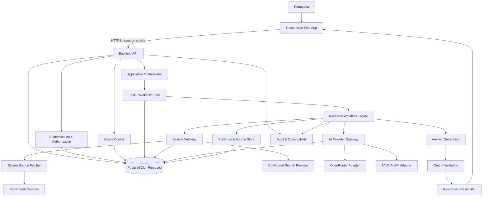
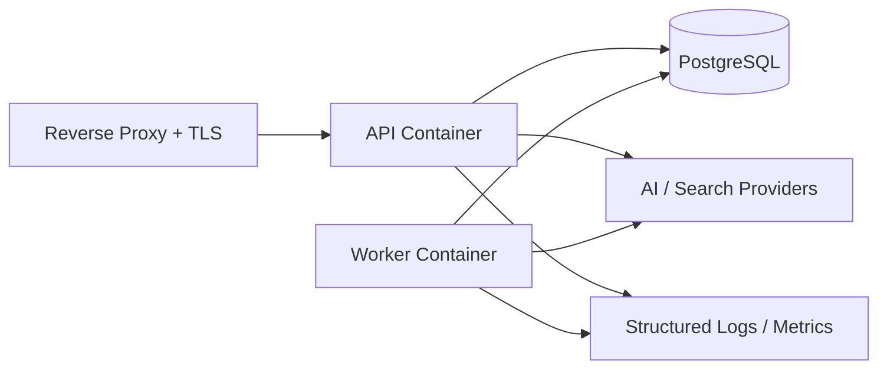
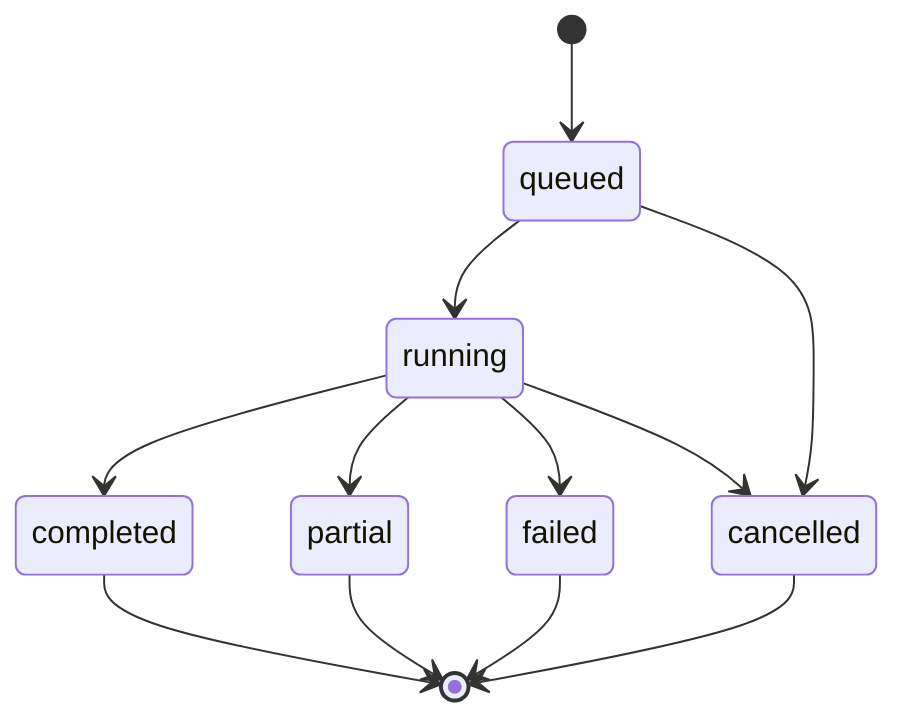

# SIKA — Technical Design

**Dokumen:** Technical Design / System Architecture Specification  
**Versi:** 0.1-draft  
**Status:** Draft untuk review, belum disetujui sebagai baseline implementasi  
**Tanggal:** 31 Oktober 2026  
**Platform target:** Responsive web app, mobile-first  
**Target beta awal:** 3 pengguna  
**Sumber normatif:** `PRD` v0.1 dan `docs/SRS.md` v0.1 dalam arsip sumber `2d689f1a8ae88e9ed824eb413e12025f8cfdfe29`

---

## 1. Tujuan dan Status Dokumen

Dokumen ini menerjemahkan PRD dan SRS SIKA menjadi rancangan teknis yang dapat ditinjau, diimplementasikan, dan diuji. Cakupannya meliputi arsitektur aplikasi, komponen backend dan frontend, alur riset berbasis bukti, integrasi AI dan pencarian, model data, autentikasi, isolasi multi-user, pengendalian penggunaan, keamanan, API, operasi, serta strategi verifikasi.

PRD dan SRS yang diberikan masih berstatus **Draft v0.1**. Karena itu, rekomendasi teknologi dan keputusan arsitektur dalam dokumen ini juga berstatus **Proposed**, bukan keputusan final yang sudah disetujui. Tidak ada bagian dokumen ini yang menyatakan bahwa kode, deployment, integrasi, atau pengujian telah dilakukan.

Urutan otoritas:

1. PRD adalah otoritas tertinggi untuk tujuan, ruang lingkup, dan prioritas produk.
2. SRS merinci persyaratan yang dapat diuji dan diturunkan dari PRD.
3. Technical Design menjelaskan cara yang diusulkan untuk memenuhi persyaratan tersebut.
4. Implementasi dan hasil pengujian harus menjadi bukti terpisah. Dokumen desain tidak menggantikan bukti tersebut.

### 1.1 Prinsip desain yang wajib dipertahankan

- **Evidence over confidence:** jawaban tidak boleh tampak lebih pasti daripada bukti yang tersedia.
- **Verifiable claims:** klaim bersumber harus dapat ditelusuri ke sumber yang benar-benar diperoleh.
- **Transparency:** fakta, asumsi, interpretasi, dan ketidakpastian harus dibedakan.
- **Controlled execution:** pemanggilan model, pencarian, retry, dan penggunaan alat harus dibatasi backend.
- **Multi-user by design:** seluruh data privat harus mempunyai pemilik dan pemeriksaan otorisasi di backend.
- **Modular boundaries:** provider AI, search, autentikasi, dan workflow tidak boleh terikat langsung ke UI.
- **Evidence-based completion:** status selesai/lulus hanya boleh diberikan setelah ada bukti eksekusi atau pengujian yang relevan.

### 1.2 Bahasa normatif

Kata **MUST/HARUS**, **MUST NOT/TIDAK BOLEH**, **SHOULD/SEBAIKNYA**, dan **MAY/BOLEH** dipakai untuk membedakan kekuatan aturan. Persyaratan normatif SRS tetap menjadi sumber utama; rekomendasi baru dalam Technical Design ditandai sebagai keputusan Proposed atau rekomendasi desain.

---

## 2. Ruang Lingkup Teknis dan Batas Produk

### 2.1 P0 — fondasi dan beta awal

Komponen P0 yang menjadi target utama beta:

- UI assistant mobile-first untuk menerima pertanyaan bahasa alami.
- Backend API dan autentikasi multi-user.
- Isolasi data dan otorisasi di backend.
- Application Orchestrator dan research workflow.
- AI Provider Gateway multi-provider.
- Search Gateway untuk sumber eksternal yang benar-benar diambil.
- Evidence model, citation mapping, dan output validation.
- Pengendalian request, token, model calls, iterasi, retry, kuota, dan pencatatan penggunaan.
- Error handling, audit event, observability, dan pengujian keamanan dasar.

### 2.2 P1 — disiapkan dalam arsitektur, dirilis setelah fondasi stabil

Dua kelompok fitur P1 dalam PRD tetap diperlakukan sebagai P1:

- **Business Analysis:** perhitungan deterministik untuk biaya, pendapatan, margin, risiko, dan skenario; pemisahan data input, asumsi, estimasi, dan proyeksi.
- **Conversation History:** menyimpan dan membuka kembali percakapan, dengan kepemilikan dan kontrol retensi/penghapusan.

Skema data dan batas API dapat disiapkan sejak awal, tetapi fitur P1 harus menggunakan feature flag atau kebijakan rilis yang jelas. P1 tidak boleh diam-diam dinyatakan sebagai fitur P0 hanya karena tabel atau endpoint dasarnya sudah tersedia.

### 2.3 Di luar cakupan dokumen ini

- Eksekusi transaksi, pemindahan dana, pembelian aset, atau trading atas nama pengguna.
- Integrasi ke rekening bank, broker, atau exchange yang tidak disebutkan PRD.
- Klaim bahwa SIKA memberi nasihat profesional/berlisensi.
- Model bisnis, monetisasi, dan lisensi distribusi final.
- Penentuan penyedia pencarian web atau model spesifik sebelum evaluasi dan persetujuan.

Perluasan ruang lingkup membutuhkan perubahan PRD/SRS dan review dampaknya.

---

## 3. Asumsi, Batasan, dan Keputusan yang Belum Final

### 3.1 Asumsi desain

1. Penggunaan awal dilakukan oleh tiga pengguna, tetapi sistem tidak memakai satu akun bersama dan tidak mengandalkan isolasi di frontend.
2. Pengguna mengakses aplikasi melalui browser modern pada perangkat mobile maupun desktop.
3. Semua kredensial provider AI dan search disimpan di lingkungan backend.
4. Model AI bersifat probabilistik. Model tidak dapat menjadi satu-satunya bukti bahwa suatu klaim benar.
5. Sumber eksternal dan input pengguna adalah data tidak tepercaya, bukan instruksi sistem.
6. Aplikasi memerlukan koneksi internet untuk provider model dan pencarian eksternal.
7. Pencarian web, retensi data, target performa, anggaran, dan pilihan hosting masih merupakan keputusan terbuka dari PRD/SRS.

### 3.2 Keputusan yang belum final

Hal-hal berikut tidak boleh dianggap telah diputuskan hanya karena ada rekomendasi di dokumen ini:

- Framework frontend dan backend.
- Database dan hosting.
- Penyedia pencarian web.
- Model AI untuk setiap kelas tugas.
- Kebijakan retensi dan penghapusan data.
- Anggaran operasional dan perlakuan saat kuota gratis habis.
- Target waktu respons dan ambang kualitas kuantitatif.
- Model bisnis dan lisensi.

### 3.3 Konfigurasi yang wajib ditetapkan sebelum beta eksternal

Nilai numerik untuk limit penggunaan dan timeout tidak ditetapkan oleh PRD/SRS. Sistem harus membaca nilai tersebut dari konfigurasi terpusat. Untuk environment beta, konfigurasi minimum wajib ditentukan dan dicatat sebelum membuka akses:

| Konfigurasi | Tujuan | Status nilai |
|---|---|---|
| `REQUESTS_PER_USER_WINDOW` | Batas request per pengguna per jendela waktu | Open; wajib ditetapkan |
| `MODEL_CALLS_PER_TASK` | Batas pemanggilan model untuk satu task | Open; wajib ditetapkan |
| `INPUT_TOKEN_LIMIT` | Batas token input per pemanggilan | Open; wajib ditetapkan |
| `OUTPUT_TOKEN_LIMIT` | Batas token output per pemanggilan | Open; wajib ditetapkan |
| `RESEARCH_ITERATION_LIMIT` | Batas iterasi riset | Open; wajib ditetapkan |
| `SEARCH_QUERY_LIMIT` | Batas kueri pencarian per task | Open; wajib ditetapkan |
| `RETRY_LIMIT` | Batas percobaan ulang | Open; wajib ditetapkan |
| `PROVIDER_TIMEOUT_SECONDS` | Timeout panggilan provider | Open; wajib ditetapkan |
| `SEARCH_TIMEOUT_SECONDS` | Timeout search/fetch | Open; wajib ditetapkan |
| `MAX_REQUEST_BODY_BYTES` | Batas ukuran request | Open; wajib ditetapkan |
| `MAX_FETCHED_CONTENT_BYTES` | Batas konten eksternal yang diproses | Open; wajib ditetapkan |
| `MAX_REDIRECTS` | Batas redirect saat fetch sumber | Open; wajib ditetapkan |

Jika konfigurasi keamanan/biaya yang wajib tidak tersedia, backend harus gagal saat startup atau menolak operasi terkait secara fail-closed. Jangan diam-diam memakai angka tak terdokumentasi.

---

## 4. Gambaran Arsitektur

### 4.1 Arsitektur logis



### 4.2 Pemisahan tanggung jawab

- **Web App:** input, tampilan percakapan, status task, sumber dan sitasi. Tidak menyimpan API key provider dan tidak membuat keputusan otorisasi.
- **Backend API:** autentikasi, validasi request, otorisasi, pembatasan penggunaan, kontrak API, dan penyajian status/hasil.
- **Application Orchestrator:** memilih jenis alur, membuat task, mengoordinasikan workflow, dan mengelola state task.
- **Research Workflow Engine:** menjalankan tahapan riset secara terstruktur dan mencatat hasil tiap tahap.
- **AI Provider Gateway:** adapter dan policy routing ke model, termasuk limit, timeout, retry, dan pencatatan penggunaan.
- **Search Gateway:** adapter layanan pencarian, pengambilan halaman yang aman, normalisasi metadata, dan pencatatan provenance.
- **Evidence & Source Store:** menyimpan sumber yang benar-benar didapatkan, klaim, relasi dukungan, serta metadata sitasi.
- **Answer Generation:** menyusun jawaban berdasarkan objek analisis/evidence, bukan sekadar menulis ulang konteks mentah.
- **Output Validation:** memeriksa struktur, keberadaan sumber, relasi klaim-sumber, status bukti, dan kontrak output sebelum jawaban dikirim.
- **Usage Control:** memutuskan apakah task dan tiap pemanggilan eksternal masih berada dalam batas yang diizinkan.

### 4.3 Deployment awal yang direkomendasikan

Rekomendasi beta adalah satu aplikasi backend yang dijalankan sebagai dua proses dari codebase yang sama: API process dan worker process. Keduanya menggunakan satu PostgreSQL instance. Worker mengambil task dari tabel antrean database menggunakan transaksi dan penguncian baris. Model ini menghindari kebutuhan Redis/queue service tambahan pada tahap tiga pengguna, tetapi tetap memisahkan request web dari pekerjaan riset yang lebih lama.



Untuk beta satu instance, worker dapat dijalankan dengan concurrency yang kecil dan dapat dikonfigurasi. Penambahan worker/replica hanya boleh dilakukan setelah strategi locking, idempotency, koneksi database, dan batas provider tervalidasi.

### 4.4 Alur request tingkat tinggi

1. Browser mengirim request ke backend melalui HTTPS.
2. Backend memvalidasi session, origin/CSRF, payload, dan ukuran request.
3. Backend mengambil `user_id` dari principal yang sudah terautentikasi, bukan dari body yang dikirim browser.
4. Usage Control memeriksa dan mereservasi kuota secara atomik.
5. Orchestrator membuat `assistant_request` dengan status `queued` dan task record.
6. Worker mengambil task, menjalankan workflow dan mengirim panggilan eksternal melalui gateway.
7. Hasil disimpan, divalidasi, dan status task berubah menjadi `completed`, `partial`, `failed`, atau `cancelled`.
8. Browser mengambil status/hasil melalui API polling. Streaming dapat ditambahkan kemudian tanpa mengubah otoritas backend.

---

## 5. Komponen dan Kontrak Tanggung Jawab

### 5.1 Responsive Web App

**Rekomendasi:** React + TypeScript dengan build tool ringan (misalnya Vite). Pemilihan ini Proposed, bukan final.

Tanggung jawab:

- Layout mobile-first dan responsive.
- Form pertanyaan, status task, jawaban, sumber, sitasi, keterbatasan, dan error message.
- Menjaga state UI saat reload atau koneksi terputus dengan mengambil status task dari API.
- Menampilkan label fakta/asumsi/interpretasi/ketidakpastian secara visual terpisah.
- Tidak memanggil provider AI/search langsung dari browser.
- Tidak menerima atau menyimpan secret provider.
- Menampilkan P1 conversation history hanya saat feature flag aktif dan kebijakan retensi telah disetujui.

Persyaratan UI:

- Navigasi utama dapat digunakan pada layar HP.
- Area baca jawaban dan sitasi tidak memaksa horizontal scrolling.
- Status `queued`, `running`, `completed`, `partial`, `failed`, dan `cancelled` dapat dibedakan.
- Error ditampilkan dalam bahasa pengguna tanpa stack trace atau kredensial.
- Link sumber memakai URL yang berasal dari record source yang telah disimpan backend.

### 5.2 Backend API

**Rekomendasi:** Python + FastAPI + Pydantic. Ini Proposed.

Tanggung jawab:

- Parsing/validasi schema request dan response.
- Authentication, session validation, authorization, CSRF, dan rate limiting.
- Membuat task dan mengembalikan request identifier.
- Menegakkan batas ukuran payload.
- Menyajikan status dan hasil task yang hanya boleh dilihat pemiliknya.
- Memanggil application service, bukan menyimpan business logic di route handler.

Route handler harus tipis. Aturan produk dan workflow ditempatkan di service layer agar bisa diuji tanpa HTTP.

### 5.3 Application Orchestrator

Tanggung jawab:

- Menentukan apakah pertanyaan dijawab tanpa riset eksternal atau memerlukan workflow riset.
- Membuat execution plan dengan jenis task dan budget yang diizinkan.
- Mengelola state transisi task.
- Menghentikan workflow jika kuota, waktu, atau batas iterasi tercapai.
- Mengubah kegagalan komponen menjadi status task/error code yang konsisten.
- Memastikan output hanya diserahkan setelah Output Validation selesai.

Orchestrator tidak melakukan pencarian web sendiri dan tidak menyimpan logika spesifik vendor.

### 5.4 Research Workflow Engine

Workflow engine menjalankan tahapan pada Bagian 6. Setiap tahap memiliki:

- Input schema dan output schema.
- Status: `pending`, `running`, `succeeded`, `failed`, atau `skipped`.
- `started_at`, `finished_at`, `duration_ms`.
- Referensi ke query, source, claim, atau artifact yang dihasilkan.
- Error code bila gagal.
- Penggunaan model/search yang diatribusikan ke task dan pengguna.

Setiap tahap harus dapat diuji sendiri. Hasil tahap sebelumnya menjadi input tahap berikutnya melalui objek terstruktur, bukan mengandalkan transkrip teks bebas saja.

### 5.5 AI Provider Gateway

Gateway menggunakan interface internal yang seragam. Contoh kontrak konseptual:

```python
class ModelProvider(Protocol):
    async def generate(self, request: ModelRequest) -> ModelResponse: ...
    async def health_check(self) -> ProviderHealth: ...
```

Implementasi adapter:

- `OpenRouterAdapter` — kandidat adapter yang disebut PRD.
- `NvidiaNimAdapter` — kandidat adapter yang disebut PRD.
- Adapter tambahan hanya setelah ToS, biaya, kemampuan, keamanan, dan contract test dinilai.

`ModelRequest` minimal memuat:

- `task_id` dan `trace_id`.
- `task_type` (misalnya question-understanding, search-planning, source-assessment, synthesis, answer-generation).
- `model_policy` atau capability yang dibutuhkan.
- `messages` yang telah dibangun backend.
- Batas input/output token.
- Timeout, retry policy, dan idempotency key bila didukung provider.
- Metadata non-sensitif untuk evaluasi.

`ModelResponse` minimal memuat:

- `provider_id`, `model_id`, dan provider request ID.
- Structured output atau text output.
- Token usage input/output jika provider menyediakannya.
- Finish reason.
- Duration.
- Error classification bila gagal.

Aturan gateway:

1. API key hanya dibaca di backend dari secret store/environment.
2. Pemilihan provider didasarkan pada capability, kebijakan tugas, availability yang baru diperiksa, ToS, dan biaya.
3. Tidak ada fallback otomatis hanya karena provider pertama gagal. Fallback hanya boleh dilakukan ke kandidat yang telah dikonfigurasi dan lolos policy check untuk task yang sama.
4. Error autentikasi, invalid request, dan pelanggaran kebijakan tidak di-retry secara buta.
5. Retry untuk kegagalan sementara harus bounded, memakai backoff, dan tidak menggandakan request non-idempotent tanpa kontrol.
6. Semua pemanggilan dicatat pada provider usage ledger.
7. Status akses gratis per endpoint/model adalah konfigurasi yang harus diverifikasi sebelum digunakan; label “free” pada UI penyedia bukan bukti bahwa akses sesuai ToS untuk pola penggunaan SIKA.
8. Jika tidak ada provider yang layak/tersedia, task berakhir dengan status yang jelas. Sistem tidak boleh berpura-pura menyelesaikan task.

### 5.6 Usage Control Service

Semua panggilan model dan search harus melalui backend service yang memeriksa budget. Tidak ada pemanggilan langsung dari workflow yang melewati kontrol ini.

Fungsi:

- Memeriksa limit per user, per task, per model call, dan per research run.
- Melakukan reservation sebelum panggilan eksternal.
- Mencatat penggunaan aktual setelah provider mengembalikan data usage.
- Menyimpan status `reserved`, `settled`, `released`, atau `unknown` agar reservation tidak dihitung dua kali.
- Menolak task baru atau menghentikan task aktif saat budget habis.
- Menyediakan informasi kuota yang dapat ditampilkan UI tanpa membocorkan detail internal provider.

Pencatatan usage harus idempotent berdasarkan call/request ID. Jika provider tidak memberi token usage, catat sebagai `unknown` atau `estimated`; jangan menampilkan estimasi sebagai angka aktual.

### 5.7 Search Gateway dan Secure Source Fetcher

Search provider masih **TBD**. Gateway harus menyembunyikan API vendor melalui interface internal:

```python
class SearchProvider(Protocol):
    async def search(self, query: SearchQuery) -> list[SearchResult]: ...
```

Gateway tidak boleh menganggap hasil snippet hasil pencarian sebagai sumber yang sudah dibaca. Untuk sitasi berbasis konten, sistem harus menyimpan bukti bahwa halaman atau konten sumber benar-benar berhasil diperoleh melalui layanan yang digunakan.

Secure Source Fetcher wajib:

- Hanya menerima skema HTTP/HTTPS.
- Menolak loopback, private, link-local, multicast, reserved, dan alamat metadata cloud IPv4/IPv6.
- Memvalidasi hasil DNS dan alamat tujuan sebelum koneksi.
- Memvalidasi ulang tujuan pada setiap redirect.
- Membatasi jumlah redirect, timeout, ukuran response, dan jenis konten.
- Menolak URL dengan credential userinfo dan port yang tidak diizinkan oleh kebijakan.
- Mencegah akses ke localhost, jaringan internal, file system, dan service metadata.
- Menghapus/menetralkan script, active content, dan elemen HTML yang tidak dibutuhkan sebelum ekstraksi teks.
- Mencatat URL asal dan URL final setelah redirect.

Aturan jaringan aktual harus diperiksa pada runtime; validasi string URL saja tidak cukup untuk mencegah SSRF atau DNS rebinding.

### 5.8 Evidence Store dan Output Validator

Evidence Store menyimpan objek source, claim, dan relasi dukungan. Output Validator menjalankan pemeriksaan deterministik terlebih dahulu sebelum pemeriksaan semantik berbantuan model.

Pemeriksaan deterministik minimal:

- Response memenuhi schema.
- Semua `source_id`/`claim_id` yang dirujuk benar-benar ada dalam task yang sama.
- Semua URL sitasi berasal dari source record yang berhasil diperoleh.
- Tidak ada URL atau bibliografi yang dibuat model tanpa source record.
- Klaim berlabel “fakta terverifikasi” memiliki satu atau lebih evidence relationship yang sesuai.
- Klaim dengan bukti parsial/bertentangan tidak dipaksa menjadi klaim pasti.
- Data tanggal publikasi/periode dicantumkan jika klaim bersifat temporal.
- Bagian hasil pencarian, penilaian/verifikasi, analisis, dan kesimpulan tidak tercampur.
- Semua angka perhitungan P1 mengacu pada calculation record yang dapat direproduksi.

Pemeriksaan semantik boleh menggunakan evaluator model atau rubric evaluasi, tetapi statusnya adalah penilaian probabilistik, bukan pembuktian kebenaran. Model evaluator tidak boleh mengubah hasil deterministik seperti keberadaan source ID atau perhitungan aritmetika.

### 5.9 Persistence / Repository Layer

Semua akses database melalui repository/service layer. Route handler dan UI tidak menulis SQL atau menentukan ownership sendiri.

Repository privat menerima authenticated principal atau `user_id` dari service yang sudah memvalidasi session. Jangan menerima `user_id` arbitrer dari request body sebagai dasar otorisasi.

---

## 6. Alur Riset Berbasis Bukti

SRS mendefinisikan delapan langkah proses riset. Untuk kebutuhan desain, tahap terakhir dipisah secara internal menjadi Answer Generation (8a) dan Output Validation (8b). Ini bukan penambahan langkah produk; ini pemisahan tanggung jawab teknis agar jawaban tidak keluar sebelum lolos pemeriksaan.

### 6.1 Tahap 1 — Memahami pertanyaan

Input: pertanyaan pengguna dan konteks task yang diizinkan.  
Output: `QuestionSpec` berisi topik, tujuan, batas waktu, geografi, entitas, jenis jawaban, tingkat kebutuhan bukti, dan istilah ambigu.

Sistem harus mendeteksi apakah pertanyaan membutuhkan pencarian eksternal. Pertanyaan definisional atau analisis yang hanya menggunakan informasi yang diberikan pengguna boleh dijawab tanpa mengaku melakukan riset. Pertanyaan yang membutuhkan kondisi terkini, data eksternal, atau klaim spesifik harus masuk ke jalur pencarian.

Ambiguitas yang material harus ditangani dengan menyatakan asumsi atau meminta satu klarifikasi. Jangan mengisi detail yang tidak diberikan pengguna sebagai fakta.

### 6.2 Tahap 2 — Menentukan kebutuhan informasi

Output: `InformationNeed` yang berisi pertanyaan turunan, data yang diperlukan, jenis sumber yang diutamakan, periode data, serta kriteria kecukupan.

Contoh kebutuhan: data historis, laporan resmi, statistik, regulasi, publikasi riset, informasi perusahaan, atau data harga. Kebutuhan spesifik ditentukan berdasarkan pertanyaan, bukan hardcoded ke satu domain.

### 6.3 Tahap 3 — Menyusun strategi pencarian

Output: `SearchPlan` dengan query, tujuan query, source preference, jumlah maksimum query, batas waktu, dan stop condition.

Stop condition harus berbasis budget dan kecukupan informasi, bukan jumlah iterasi tak terbatas. Search plan harus dapat ditinjau dan disimpan sebagai artifact workflow.

### 6.4 Tahap 4 — Mengambil sumber eksternal

Search Gateway menjalankan query ke provider yang telah dikonfigurasi. Hasil disimpan sebagai `SearchResult`; halaman yang dipakai untuk dukungan klaim diproses melalui Secure Source Fetcher atau mekanisme pengambilan resmi dari provider yang memenuhi kebutuhan provenance.

Kegagalan search harus menghasilkan error/partial result yang transparan. Sumber yang tidak berhasil diperoleh tidak boleh ditampilkan sebagai sumber yang telah diperiksa.

### 6.5 Tahap 5 — Memeriksa relevansi dan kecocokan sumber

Setiap source dievaluasi terhadap pertanyaan dan klaim yang hendak didukung. Simpan hasil penilaian per source, bukan satu skor umum untuk seluruh riset.

Kriteria:

- Relevansi topik dan konteks.
- Kesesuaian isi dengan klaim spesifik.
- Kredibilitas penerbit/penulis dan jenis dokumen.
- Tanggal publikasi dan periode data.
- Konsistensi angka, tanggal, satuan, dan definisi.
- Keterbatasan metode/data.

Status minimal source: `retrieved`, `fetch_failed`, `reviewed`, `rejected`, atau `insufficient`. Status source tidak sama dengan status klaim. Source yang kredibel tetap dapat tidak mendukung klaim tertentu.

### 6.6 Tahap 6 — Membandingkan temuan dan mengidentifikasi konflik

Sistem membandingkan sumber yang membahas klaim/indikator sama. Konflik tidak boleh disembunyikan dengan memilih angka yang paling cocok dengan jawaban yang ingin ditulis.

Simpan perbedaan definisi, periode, cakupan, satuan, metodologi, dan publikasi. Bila konflik tidak dapat diselesaikan, jawaban harus menyatakan adanya perbedaan dan menjelaskan kemungkinan penyebab bila ada bukti.

### 6.7 Tahap 7 — Menyusun analisis

Analisis dibangun dari claim-evidence graph. Setiap klaim memiliki status dukungan dan daftar evidence relationship. Interpretasi yang melampaui isi sumber harus ditandai sebagai interpretasi, bukan fakta sumber.

### 6.8 Tahap 8a — Answer Generation

Generator menyusun jawaban berdasarkan `QuestionSpec`, analysis artifacts, claim records, dan citations yang telah ada. Output mengandung bagian yang sesuai kebutuhan:

- Jawaban inti.
- Temuan dari sumber.
- Fakta yang didukung bukti.
- Asumsi yang digunakan.
- Interpretasi/analisis.
- Ketidakpastian atau pertentangan.
- Keterbatasan sumber/data/metode.
- Daftar sumber yang benar-benar diambil.

Generator tidak diperbolehkan menambah citation URL yang tidak ada di Source Store.

### 6.9 Tahap 8b — Output Validation

Validator menjalankan pemeriksaan di Bagian 5.8. Bila ada klaim faktual tanpa bukti memadai, sistem harus mengubah label/status, menghapus klaim, atau menyatakan keterbatasannya. Bila response schema atau hubungan sumber tidak valid, jawaban tidak boleh diserahkan sebagai hasil tervalidasi.

Jika validasi gagal total, task berakhir dengan error yang aman atau jawaban parsial yang secara eksplisit ditandai belum lengkap. Tidak boleh menyatakan “terverifikasi” hanya karena model menghasilkan label tersebut.

### 6.10 Artifact per tahap

| Tahap | Artifact minimum | Dapat diverifikasi melalui |
|---|---|---|
| 1 | `QuestionSpec` | Record hasil ekstraksi pertanyaan |
| 2 | `InformationNeed` | Daftar kebutuhan informasi |
| 3 | `SearchPlan` | Query, tujuan, stop condition, budget |
| 4 | `SearchExecution` + `Source` | Log eksekusi, provider request ID, source record |
| 5 | `SourceAssessment` | Penilaian relevansi/kredibilitas/kecocokan |
| 6 | `FindingComparison` | Perbandingan dan konflik antar-sumber |
| 7 | `AnalysisArtifact` + `Claim` | Analisis dan claim-evidence mapping |
| 8a | `AnswerDraft` | Draft output dan referensi claim/source |
| 8b | `ValidationReport` | Hasil schema, citation, evidence, dan policy validation |

Artifact ini merupakan data audit workflow, bukan janji bahwa setiap evaluasi semantik selalu benar.

---

## 7. Model Data Evidence dan Provenance

### 7.1 Source record

Setiap sumber yang dipakai harus memiliki record minimal:

| Field | Keterangan |
|---|---|
| `id` | ID internal unik |
| `research_run_id` | Research run pemilik source |
| `provider_id` | Search/fetch provider asal |
| `original_url` | URL dari hasil pencarian atau input sumber |
| `canonical_url` | URL normalisasi jika dapat ditentukan |
| `final_url` | URL final setelah redirect yang tervalidasi |
| `title` | Judul yang diperoleh dari sumber |
| `publisher` | Penerbit/situs jika diketahui |
| `author` | Penulis jika tersedia |
| `published_at` | Tanggal publikasi jika tersedia; nullable |
| `retrieved_at` | Waktu konten berhasil diperoleh |
| `content_period` | Periode data yang dibahas, bila dapat diekstrak |
| `content_type` | HTML/PDF/JSON/dll. yang diizinkan |
| `content_hash` | Hash konten yang diambil untuk provenance |
| `fetch_status` | Status fetch dan ekstraksi |
| `excerpt_refs` | Referensi potongan teks yang dipakai |

Metadata yang tidak diketahui harus tetap null atau `unknown`; jangan ditebak. Penyimpanan konten penuh perlu dibatasi oleh retensi, ukuran, hak penggunaan, dan kebijakan provider. Simpan excerpt secukupnya untuk audit bila lisensi dan kebijakan mengizinkan.

### 7.2 Claim dan evidence relationship

Objek `Claim` minimal berisi:

- `claim_id`.
- `research_run_id`.
- `claim_text`.
- `claim_type`: `fact`, `assumption`, `interpretation`, `uncertainty`.
- `support_status`: `supported`, `partially_supported`, `contradicted`, `unsupported`, `unverified`.
- `temporal_scope` dan `unit` bila relevan.

Objek `ClaimEvidence` menghubungkan satu claim dengan satu source/excerpt, dengan atribut:

- `relationship`: `supports`, `partially_supports`, `contradicts`, `contextualizes`.
- `evidence_excerpt_ref`.
- `assessment_note`.
- `assessed_at`.

Satu klaim dapat memiliki beberapa sumber dan satu sumber dapat mendukung/menyanggah beberapa klaim. Relasi ini menjadi dasar sitasi claim-level.

### 7.3 Prinsip sitasi

- Citation ID harus berasal dari Source Store pada task yang sama.
- URL citation harus berasal dari `final_url` atau URL tervalidasi yang disimpan.
- Sitasi tidak boleh dibuat dari ingatan model.
- Sumber yang hanya muncul di search snippet harus diberi status berbeda dari halaman yang berhasil diperoleh.
- Klaim temporal harus mengungkap publikasi dan/atau periode data yang relevan.
- Sumber yang bertentangan harus ditampilkan dengan konteks, bukan dihilangkan.

### 7.4 Perbedaan status

`Retrieved` artinya sumber berhasil diperoleh. `Reviewed` artinya sumber dievaluasi. `Supports` artinya suatu source dinilai mendukung klaim tertentu. Tidak satu pun status tersebut, sendirian, merupakan jaminan kebenaran universal. Penilaian semantik harus memiliki keterbatasan dan dievaluasi dengan test set.

---

## 8. Kontrak Output dan Jawaban

### 8.1 Structured response internal

Respons internal direkomendasikan menggunakan schema versioned, misalnya:

```json
{
  "schema_version": "1.0",
  "request_id": "req_...",
  "status": "completed",
  "answer": {
    "summary": "...",
    "sections": [],
    "limitations": [],
    "uncertainties": []
  },
  "claims": [
    {
      "claim_id": "clm_...",
      "text": "...",
      "type": "fact",
      "support_status": "supported",
      "source_ids": ["src_..."]
    }
  ],
  "sources": [],
  "research_summary": {
    "searched": true,
    "sources_retrieved": 0,
    "sources_reviewed": 0,
    "conflicts_found": 0
  },
  "validation": {
    "schema_valid": true,
    "citation_integrity_valid": true,
    "evidence_validation_status": "passed_with_limits"
  }
}
```

Contoh ini hanya schema ilustratif. Nilai aktual berasal dari eksekusi. UI boleh merender dalam format yang lebih ramah pengguna, tetapi backend tetap menjadi otoritas status dan provenance.

### 8.2 Status jawaban

- `completed`: workflow selesai dan output lolos validasi wajib.
- `partial`: sebagian workflow selesai; keterbatasan dan tahap yang gagal dijelaskan.
- `failed`: tidak ada jawaban yang layak diserahkan.
- `cancelled`: dibatalkan pengguna atau kebijakan.

Status `completed` tidak berarti semua klaim benar secara absolut. Artinya kontrak dan pemeriksaan yang ditentukan telah berhasil dijalankan. Kualitas isi tetap harus dievaluasi melalui test suite dan review.

### 8.3 Jangan klaim verifikasi palsu

Apabila pencarian tidak dijalankan, response harus menyatakan bahwa jawaban tidak didasarkan pada pencarian langsung. Apabila pencarian gagal atau tidak menghasilkan sumber, response harus menyebutkan hal itu. Jangan menampilkan daftar sumber generik sebagai sumber yang telah diakses.

---

## 9. Identitas, Autentikasi, dan Isolasi Multi-User

### 9.1 Rekomendasi autentikasi

Untuk web app same-origin, rekomendasi awal adalah email/password dengan password hashing Argon2id dan server-side opaque session cookie. Ini merupakan keputusan Proposed. OIDC dapat dipertimbangkan sebagai pilihan lanjutan jika kebutuhan login sosial/enterprise muncul.

Alur:

1. Registrasi/login memvalidasi input dan kredensial di backend.
2. Password disimpan hanya sebagai Argon2id password hash beserta parameter versi.
3. Backend membuat session token acak dengan entropy tinggi.
4. Browser menerima token melalui cookie `HttpOnly`, `Secure`, `SameSite=Lax` (atau stricter bila alur mendukung), dan scope path/host minimum.
5. Database hanya menyimpan hash session token, user ID, created/expiry/revoked timestamps, dan metadata minimum.
6. Setiap request privat memvalidasi session aktif dan expiry di backend.
7. Logout mencabut session di database. Session yang dicabut tidak boleh dipakai lagi.

Opaque session dipilih sebagai rekomendasi karena browser-first app memerlukan revocation sederhana dan tidak membutuhkan JWT stateless. Bila kelak dipilih JWT, spesifikasi signature, issuer, audience, expiry, rotation, revocation, refresh, dan session semantics harus ditulis terpisah; jangan mencampur validasi JWT dengan validasi session secara ambigu.

### 9.2 Authorization rule

- `user_id` hanya berasal dari session/principal yang telah divalidasi.
- Semua query resource privat wajib dibatasi ke user tersebut.
- ID resource dari browser hanya locator; bukan bukti kepemilikan.
- Semua read/update/delete harus menjalankan ownership check di service/repository.
- Object-level authorization harus diuji untuk ID valid milik akun lain, bukan hanya untuk ID acak yang tidak ada.
- Response untuk resource milik pengguna lain tidak boleh membocorkan apakah resource tersebut ada; gunakan respons not-found/forbidden yang konsisten sesuai kebijakan.

### 9.3 Isolasi di database

Setiap tabel data privat harus memiliki `user_id` atau dapat diturunkan melalui relasi yang tervalidasi. Gunakan foreign key komposit yang menyertakan owner ID untuk mencegah relasi lintas pemilik.

Contoh konseptual:

- `conversations` memiliki `UNIQUE (user_id, id)`.
- `messages` menyimpan `user_id` dan `conversation_id`, dengan FK `(user_id, conversation_id)` ke conversations.
- `research_runs` menyimpan `user_id` dan relasi parent yang owner-nya sama.

PostgreSQL Row-Level Security dapat ditambahkan sebagai defense-in-depth setelah connection context dan pool reset diuji. RLS tidak menggantikan validasi application-level dan integration test.

### 9.4 Session security

- Cookie tidak boleh dapat dibaca JavaScript.
- Gunakan HTTPS pada environment non-local.
- Lindungi mutasi state-changing dari CSRF; SameSite cookie bukan satu-satunya kontrol.
- Validasi Origin/Referer sesuai kebijakan deployment.
- Regenerasi session setelah login dan perubahan hak akses.
- Batasi percobaan login dan audit kegagalan yang relevan.
- Expiry dan idle timeout harus dapat dikonfigurasi dan diputuskan sebelum rilis.
- Jangan menaruh token session atau password ke log.

---

## 10. Conversation dan Message Storage (P1)

### 10.1 Batas P1

Conversation History adalah P1 menurut PRD. Desain data boleh disiapkan sejak awal, tetapi UI untuk membuka riwayat dan lifecycle retensi tidak boleh dianggap selesai sebelum kebijakan disetujui dan ACC-019 dipenuhi.

### 10.2 Entitas

`Conversation`:

- `id`, `user_id`, `title`, `created_at`, `updated_at`, `deleted_at`.
- Status deletion harus mendukung soft-delete sementara sebelum purge permanen jika kebijakan mengharuskan.

`Message`:

- `id`, `user_id`, `conversation_id`, `role`, `content_ref`/`content`, `created_at`, `sequence_no`, `request_id`.
- Role dibatasi ke enum internal (misalnya user/assistant/system metadata); konten system prompt tidak boleh disimpan sebagai message user-facing.

`AssistantRequest`:

- `id`, `user_id`, `conversation_id` nullable sesuai fase fitur, `input_message_id` nullable, `status`, `created_at`, `finished_at`, `error_code`.

### 10.3 API history

Endpoint P1 yang disiapkan:

- `POST /api/v1/conversations`
- `GET /api/v1/conversations`
- `GET /api/v1/conversations/{conversation_id}`
- `PATCH /api/v1/conversations/{conversation_id}`
- `DELETE /api/v1/conversations/{conversation_id}`

Setiap endpoint harus memeriksa ownership di backend. Pagination harus cursor-based atau memiliki ordering stabil. Penghapusan mengikuti retention/deletion policy yang telah disetujui.

### 10.4 Retensi dan penghapusan

Retensi adalah keputusan terbuka dan **release blocker sebelum rilis publik**. Minimal kebijakan final harus menjelaskan:

- Data apa yang disimpan (prompt, jawaban, sumber, excerpt, metadata, log).
- Tujuan penyimpanan tiap kategori.
- Retensi aktif dan masa backup.
- Cara pengguna meminta penghapusan.
- Waktu purge dari database utama, search index/cache, dan backup sesuai siklus yang dijelaskan.
- Pengecualian audit/legal bila ada.
- Cara pengguna diberi informasi dan menyetujui kebijakan.

Sebelum keputusan tersebut ada, jangan mengaktifkan publikasi Conversation History. Untuk beta terbatas, pemilik produk harus menetapkan pemberitahuan dan batas retensi sementara secara eksplisit sebelum data pengguna nyata disimpan.

---

## 11. Business Analysis (P1)

### 11.1 Pemisahan LLM dan calculator

LLM bertugas memahami permintaan, mengidentifikasi variabel, menjelaskan asumsi, dan menyajikan interpretasi. Perhitungan aritmetika yang dapat direproduksi dilakukan oleh deterministic calculation service, bukan dipercayakan hanya pada teks model.

### 11.2 Calculation record

Setiap perhitungan harus menyimpan:

- Input value dan satuan.
- Sumber setiap input: user-provided, externally sourced, atau system estimate.
- Rumus/operasi.
- Rounding policy.
- Output value dan satuan.
- Asumsi dan batasan.
- Versi calculator/logic.

Contoh klasifikasi:

- **Data pengguna:** angka yang secara eksplisit dimasukkan pengguna.
- **Data sumber:** angka yang berasal dari source record dan sitasi.
- **Estimasi:** nilai yang diperkirakan sistem dan harus diberi label.
- **Asumsi:** input yang dipakai untuk simulasi tetapi belum terbukti.
- **Proyeksi:** skenario bersyarat, bukan hasil pasti.

### 11.3 Validasi

Unit test calculator harus mencakup angka normal, nol, negatif jika relevan, pembagian nol, perubahan satuan, pembulatan, nilai ekstrim, input hilang, dan konsistensi hasil. ACC-006 hanya dapat dinyatakan lulus setelah skenario uji yang disepakati dijalankan.

---

## 12. API Design

### 12.1 Prinsip umum

- Prefix versi: `/api/v1`.
- HTTPS untuk deployment non-local.
- JSON request/response untuk API utama.
- Pydantic/schema validation di backend.
- Request ID dan trace ID untuk korelasi.
- Error response memiliki `code`, `message`, `request_id`, dan `retryable`.
- Detail internal, stack trace, provider secret, dan raw upstream error tidak dikirim ke pengguna.
- Seluruh endpoint privat memerlukan session valid dan ownership check.

### 12.2 Endpoint inti P0

| Method | Endpoint | Tujuan | Otorisasi |
|---|---|---|---|
| POST | `/api/v1/auth/register` | Membuat akun jika registrasi dibuka | Public + abuse controls |
| POST | `/api/v1/auth/login` | Membuat session | Public + rate limit |
| POST | `/api/v1/auth/logout` | Mencabut session aktif | Authenticated |
| GET | `/api/v1/auth/me` | Informasi akun aktif | Authenticated |
| POST | `/api/v1/assistant/requests` | Membuat assistant/research task | Authenticated + quota |
| GET | `/api/v1/assistant/requests/{request_id}` | Mengambil status/hasil task | Pemilik task saja |
| POST | `/api/v1/assistant/requests/{request_id}/cancel` | Membatalkan task yang masih berjalan | Pemilik task saja |
| GET | `/api/v1/usage` | Ringkasan usage pengguna | Pemilik akun saja |

Endpoint register dapat dinonaktifkan untuk beta invite-only; tidak boleh ada endpoint admin publik tanpa kebutuhan dan kontrol khusus.

### 12.3 Endpoint P1

| Method | Endpoint | Tujuan |
|---|---|---|
| POST | `/api/v1/conversations` | Membuat percakapan |
| GET | `/api/v1/conversations` | Daftar percakapan pengguna |
| GET | `/api/v1/conversations/{conversation_id}` | Detail dan pesan percakapan |
| PATCH | `/api/v1/conversations/{conversation_id}` | Ubah metadata yang diizinkan |
| DELETE | `/api/v1/conversations/{conversation_id}` | Memulai penghapusan sesuai policy |

Semua endpoint P1 harus feature-gated sampai kebijakan retensi disetujui.

### 12.4 Create request contract

Request konseptual:

```json
{
  "message": "Pertanyaan pengguna",
  "conversation_id": null,
  "mode": "auto",
  "client_request_id": "uuid-or-random-id"
}
```

Aturan:

- `message` wajib non-empty dan tunduk pada limit ukuran.
- `conversation_id` opsional hanya jika P1/fitur percakapan diaktifkan; bila disertakan, ownership diperiksa.
- `mode` tidak boleh memberi hak memilih provider bebas dari browser. Nilainya hanya memilih mode produk yang disetujui.
- `client_request_id` dipakai untuk idempotency sesuai kebijakan.
- `user_id`, provider ID, model ID, dan quota tidak dipercaya bila dikirim browser.

Response awal:

```json
{
  "request_id": "req_...",
  "status": "queued",
  "status_url": "/api/v1/assistant/requests/req_..."
}
```

### 12.5 Error contract

Kode minimum:

| Error code | Makna | Retry |
|---|---|---|
| `AUTH_REQUIRED` | Session tidak ada/tidak valid | Tidak, login ulang |
| `ACCESS_DENIED` | Resource bukan milik pengguna | Tidak |
| `VALIDATION_ERROR` | Payload tidak valid | Setelah input diperbaiki |
| `RATE_LIMITED` | Request limit tercapai | Setelah jendela limit berakhir |
| `QUOTA_EXCEEDED` | Budget penggunaan habis | Tidak sampai kuota tersedia |
| `PROVIDER_UNAVAILABLE` | Provider yang layak tidak tersedia | Mungkin; policy-controlled |
| `SEARCH_UNAVAILABLE` | Search provider gagal/tidak tersedia | Mungkin; policy-controlled |
| `RESEARCH_INSUFFICIENT_EVIDENCE` | Bukti tidak memadai | Tidak otomatis |
| `OUTPUT_VALIDATION_FAILED` | Output tidak lolos kontrak wajib | Tidak otomatis |
| `TASK_CANCELLED` | Task dibatalkan | Tidak |
| `INTERNAL_ERROR` | Error internal yang tidak diklasifikasikan | Request ID untuk support |

Pesan ke pengguna harus menjelaskan langkah berikutnya tanpa membocorkan penyebab rahasia atau detail security.

---

## 13. Reliability, Task Lifecycle, dan Error Handling

### 13.1 Task state machine



Transisi state dilakukan oleh service backend dengan conditional update/transaction. Task tidak boleh kembali ke `queued` atau `running` setelah terminal state tanpa membuat task baru atau retry event yang eksplisit.

### 13.2 Worker safety

- Worker mengklaim task secara atomik dengan row lock/lease.
- Lease/heartbeat digunakan agar task yang ditinggalkan worker crash dapat ditemukan.
- Worker tidak boleh menjalankan task yang sama secara bersamaan tanpa idempotency control.
- Tiap external call memiliki call record dan idempotency key internal.
- Setelah restart, worker merekonsiliasi task stale dan memutuskan retry/fail berdasarkan tahap terakhir dan kebijakan.

### 13.3 Retry policy

Retry dibatasi dan dikonfigurasi. Klasifikasi:

- **Retryable:** timeout sementara, 429 sesuai retry-after dan budget, 5xx sementara, koneksi terputus sebelum hasil diketahui (dengan idempotency check).
- **Non-retryable:** invalid request, kredensial tidak valid, permission denied, ToS/policy block, payload terlalu besar, output yang secara deterministik tidak valid.
- **Conditional:** quota/provider capacity error; harus dicek terhadap ketersediaan dan policy, bukan diulang tanpa batas.

Backoff eksponensial dengan jitter dapat digunakan untuk error retryable. Jumlah maksimum retry wajib berasal dari konfigurasi. Jangan retry satu kali pun bila itu akan melanggar budget atau menggandakan biaya tanpa kontrol.

### 13.4 Timeout dan cancellation

Timeout harus diterapkan per boundary: API request, model call, search query, source fetch, dan keseluruhan research task. Cancellation menghentikan tahap berikutnya dan mengirim cancellation upstream bila provider mendukung. Hasil yang sudah dibayar/selesai tetap dicatat di usage ledger.

### 13.5 Error containment

- Upstream provider error dikonversi menjadi internal error class.
- User response berisi pesan aman dan request ID.
- Log internal dapat memuat status code/provider request ID yang tidak sensitif.
- Tidak boleh menampilkan API key, cookie, password, raw authorization header, atau prompt internal.
- Kegagalan search menghasilkan partial/failed sesuai evidence yang telah dikumpulkan; tidak boleh dipresentasikan sebagai successful research.

---

## 14. Security dan Privacy Design

### 14.1 Threat model ringkas

| Ancaman | Dampak | Kontrol desain |
|---|---|---|
| Credential theft/brute force | Pengambilalihan akun | Argon2id, login throttling, session revocation, secure cookie |
| Broken object-level authorization | Kebocoran data antar-user | Owner-scoped query, composite FK, integration tests |
| API key leakage | Penyalahgunaan provider | Server-side secrets, redaction, no key in frontend |
| Prompt injection via web content | Tool misuse/manipulated answer | Treat source as untrusted data, tool allowlist, no instruction delegation |
| SSRF/DNS rebinding | Akses jaringan internal | IP validation, redirect revalidation, egress controls |
| XSS/unsafe HTML | Session theft/content execution | Output escaping, sanitized extracted content, CSP |
| DoS/cost abuse | Habis kuota/biaya | User/IP rate limits, budgets, body/content caps, bounded tasks |
| Sensitive logging | Kebocoran prompt/PII | Data minimization, redaction, controlled access, retention policy |
| Provider compromise/outage | Gagal layanan atau exposure | Least privilege, provider adapter, timeout, provider policy |
| Dependency compromise | RCE/data theft | Lockfiles, dependency scanning, patch policy, secret isolation |

### 14.2 Input dan prompt-injection defense

- Input user dan konten web dimasukkan sebagai data yang tidak tepercaya.
- Teks sumber tidak boleh memperoleh status system/developer instruction.
- Tool invocation dikendalikan orchestrator melalui daftar fungsi yang diizinkan; jangan memberikan model akses bebas ke shell, database, atau URL arbitrary.
- Structured output divalidasi dengan schema.
- Model tidak boleh menentukan sendiri akses user atau limit quota.
- Jika ditemukan instruksi di dalam sumber yang meminta rahasia, perubahan policy, atau tool call, konten itu diperlakukan sebagai materi sumber dan diabaikan sebagai instruksi.

### 14.3 SSRF dan egress

Secure Source Fetcher harus menerapkan kontrol Bagian 5.7. Secara deployment, network egress dibatasi ke layanan AI/search dan web publik sesuai kebutuhan. Akses ke database, internal control plane, cloud metadata, dan localhost tidak boleh tersedia bagi fetcher.

### 14.4 Secret management

- Secret berasal dari environment/secret manager, bukan repository atau frontend bundle.
- Secret tidak pernah ditulis ke logs, analytics, error body, atau crash dump.
- Akses secret mengikuti least privilege.
- Rotasi dan revocation harus didukung oleh prosedur operasi.
- `.env` lokal tidak boleh di-commit; sediakan `.env.example` hanya dengan placeholder.

### 14.5 Data minimization dan logging

Log default menyimpan event metadata: timestamp, trace ID, task ID, user pseudonymous ID, component, status, duration, error class, provider/model ID, dan usage counters. Prompt, jawaban penuh, excerpt sumber, password, cookie, session token, API key, dan data pribadi tidak dicatat secara default.

Jika payload diperlukan untuk debug, harus ada alasan, akses terbatas, redaction, retensi pendek yang disetujui, dan audit. Jangan menjadikan debug logging sebagai tempat penyimpanan percakapan.

### 14.6 Security testing

Security verification mencakup authentication, authorization, cross-user access, session revocation, CSRF, XSS, SSRF, prompt injection, secret leakage, rate limit bypass, quota bypass, dependency scanning, dan log redaction. Test harus menghasilkan output yang dapat direview.

---

## 15. Observability dan Audit

### 15.1 Correlation identifiers

Setiap HTTP request memiliki `request_id` dan `trace_id`. Setiap assistant task memiliki `task_id`; setiap provider/search call memiliki `external_call_id`. ID dikorelasikan tanpa menyimpan secret.

### 15.2 Metrics

Metric minimum:

- Request count, success, partial, failed, cancelled.
- Latency API dan durasi task berdasarkan task type.
- Provider calls per provider/model/status.
- Search requests dan fetch status.
- Token usage aktual/estimated/unknown.
- Quota reservation/settlement/rejection.
- Retry count dan timeout count.
- Research steps failed atau skipped.
- Output validation pass/fail category.
- Isolasi/access denial events.

Jangan menetapkan SLO numerik sebelum deployment, karakteristik tugas, dan baseline beta diketahui. NFR-002 tetap open decision.

### 15.3 Audit events

Audit log mencatat aktivitas keamanan dan operasional yang relevan, seperti login success/failure, logout/revoke session, authorization denial, limit enforcement, perubahan konfigurasi sensitif, admin access, dan deletion events. Audit event harus memiliki actor, action, target type/id, timestamp, outcome, dan request ID.

Audit event tidak boleh memuat password, token, API key, atau full prompt secara default. Akses baca audit log dibatasi.

---

## 16. Configuration, Secrets, dan Feature Flags

### 16.1 Konfigurasi terpusat

Satu konfigurasi backend tervalidasi menjadi sumber nilai bagi:

- Provider/model enablement dan capability policy.
- Search provider enablement.
- Usage limits dan task budgets.
- Timeouts, retry limits, fetch limits, redirect limits.
- Session lifetime dan login throttling.
- Feature flags P1.
- Retention policy dan logging controls.

Jangan menduplikasi nilai limit di frontend, worker, dan API. Worker/API harus membaca konfigurasi yang konsisten dan mencatat versi konfigurasi yang dipakai pada task.

### 16.2 Startup validation

Production/beta startup harus gagal atau menolak fitur yang memerlukan konfigurasi jika:

- Secret provider yang diperlukan hilang.
- Tidak ada provider/search adapter yang diaktifkan untuk fitur tersebut.
- Limit keamanan/biaya wajib belum ditetapkan.
- Database/migration version tidak kompatibel.
- Cookie/session security configuration tidak aman untuk environment publik.

### 16.3 Feature flags

Minimal flag:

- `FEATURE_RESEARCH_ENABLED`
- `FEATURE_BUSINESS_ANALYSIS_ENABLED` (P1)
- `FEATURE_CONVERSATION_HISTORY_ENABLED` (P1)
- `FEATURE_PROVIDER_FALLBACK_ENABLED` (default false sampai policy disetujui)
- `FEATURE_STREAMING_ENABLED` (opsional)

Flag bukan pengganti authorization. Endpoint P1 tetap memerlukan ownership dan policy yang sama.

---

## 17. Database, Migration, Backup, dan Recovery

### 17.1 Rekomendasi database

**Proposed: PostgreSQL** untuk beta dan pengembangan berikutnya. Alasan: transaksi, foreign key komposit, concurrency write yang lebih sesuai untuk task queue/usage ledger, serta jalur skalabilitas multi-user. Untuk tiga pengguna, PostgreSQL mungkin lebih banyak operasi dibanding SQLite, tetapi mendukung worker DB-backed dan konsistensi quota lebih baik.

SQLite dapat menjadi alternatif development lokal atau prototype single-process, tetapi bila dipakai untuk deployment beta, concurrency, locking, backup, migration, dan multi-worker harus diuji secara eksplisit. Jangan memilih SQLite sekaligus menjalankan beberapa worker yang menimbulkan contention tanpa benchmark dan concurrency test.

### 17.2 Entitas/tabel logis

| Entitas | Fungsi | Prioritas |
|---|---|---|
| `users` | Identitas akun | P0 |
| `sessions` | Session aktif/revoked | P0 |
| `assistant_requests` | Task utama dan lifecycle | P0 |
| `research_runs` | Workflow riset per task | P0 |
| `research_steps` | State dan artifacts tiap tahap | P0 |
| `search_queries` | Query dan hasil search metadata | P0 |
| `sources` | Source provenance dan fetch status | P0 |
| `claims` | Klaim terstruktur | P0 |
| `claim_evidence` | Hubungan claim-source | P0 |
| `provider_calls` | Catatan model/search call | P0 |
| `usage_ledger` | Reservation dan penggunaan | P0 |
| `usage_counters` | Counter/window per user | P0 |
| `audit_events` | Audit aktivitas penting | P0 |
| `conversations` | Container percakapan | P1 (schema can be prepared) |
| `messages` | Pesan percakapan | P1 (schema can be prepared) |
| `calculation_records` | Input/rule/output analisis bisnis | P1 |
| `schema_migrations` | Versi migrasi | P0 |

Semua tabel privat harus memiliki `user_id` langsung atau foreign key owner-safe. Index diperlukan untuk `user_id`, status, created_at, expiry, task ID, dan query path yang benar-benar digunakan. Hindari menyimpan raw HTML/full page bila metadata + excerpt yang diperlukan sudah cukup.

### 17.3 Migration strategy

- Migration memiliki versi unik dan berurutan.
- Migration otomatis dijalankan hanya melalui pipeline terkontrol, bukan oleh setiap worker secara bersamaan.
- Backup dilakukan sebelum migration yang berisiko.
- Migration memiliki precondition, perubahan schema, dan postcondition.
- Perubahan destruktif menggunakan pola expand-migrate-contract bila diperlukan.
- Rollback schema dan pemulihan data diperlakukan sebagai dua hal berbeda.
- Migration gagal harus menghentikan deployment; jangan lanjut dengan schema setengah berubah.
- Pengujian migration dijalankan pada salinan data representatif di environment test.

### 17.4 Backup dan restore

- Backup dienkripsi saat tersimpan.
- Kunci enkripsi disimpan terpisah dari file backup dan diakses secara least privilege.
- Retensi backup ditentukan bersama data-retention policy.
- Restore diuji secara berkala pada environment terisolasi.
- Verifikasi mencakup integrity check database dan application-level smoke test.
- Aplikasi tidak boleh resume write traffic sebelum restore diverifikasi.
- Prosedur key rotation, backup retention, dan target RPO/RTO masih harus diputuskan sebelum rilis yang membawa data penting.

---

## 18. Deployment dan Operasi

### 18.1 Komponen deployment minimum

- Reverse proxy dengan TLS.
- Web static assets (dapat disajikan oleh CDN/reverse proxy atau frontend hosting).
- Backend API process.
- Research worker process.
- PostgreSQL.
- Secret/configuration management.
- Centralized structured logs dan metrics.

### 18.2 Environment

Pisahkan sekurangnya:

- `local`: pengembangan, provider dummy/mock tersedia.
- `test`: integration/contract/security test; tidak memakai data pengguna nyata.
- `beta`: akses terbatas untuk tiga pengguna; quota ketat dan logging redacted.
- `production`: tidak dibuka sebelum acceptance gate, retention policy, security review, ToS check, dan operational readiness disetujui.

### 18.3 Deployment guard

Deployment tidak boleh berjalan bila migration gagal, secret wajib hilang, konfigurasi limit tidak valid, atau test gate wajib gagal. Setiap release harus mencatat commit/build identifier, migration version, dan config version.

### 18.4 Backup/restore dan insiden

Runbook minimal harus mencakup provider outage, search outage, quota exhausted, database unavailable, worker stuck, secret leak, cross-user access incident, suspected prompt injection, restore, dan user deletion request.

---

## 19. Test Architecture dan Acceptance Mapping

### 19.1 Lapisan test

1. **Unit tests:** service, state machine, quota math, source normalization, validators, calculator P1.
2. **Integration tests:** API + database, session, ownership, queue, workflow persistence.
3. **Contract tests:** model provider adapters, search provider, secure fetch, provider response schema.
4. **Security tests:** authentication, authorization, tenant isolation, SSRF, prompt injection, XSS, CSRF, secret redaction, quota abuse.
5. **Workflow tests:** setiap research step secara individual dan end-to-end.
6. **Evaluation tests:** claim-support accuracy, citation integrity, source quality, conflict disclosure, uncertainty labeling.
7. **Regression tests:** menjalankan kumpulan test relevan setelah perubahan dan seluruh release suite sesuai risiko.
8. **Mobile tests:** layout, readability, navigation, request state, reload/reconnect pada perangkat mobile.

### 19.2 Acceptance criteria

| ACC | Bukti yang harus tersedia | Gate |
|---|---|---|
| ACC-001 | Hasil uji alur utama dengan tiga pengguna | Beta gate |
| ACC-002 | Auth/authorization test report | Beta gate |
| ACC-003 | Cross-user negative test report tanpa kebocoran | Beta gate |
| ACC-004 | Citation-to-source audit untuk output riset | Beta gate |
| ACC-005 | Test no-search/no-source dan fabricated-source prevention | Beta gate |
| ACC-006 | Calculator test report untuk business analysis | P1 gate |
| ACC-007 | Usage ledger dan quota test report | Beta gate |
| ACC-008 | Simulasi provider failure dan graceful handling | Beta gate |
| ACC-009 | Integration test report backend, DB, provider, search | Beta gate |
| ACC-010 | Contract test report untuk external integrations | Beta gate |
| ACC-011 | Data isolation test suite lulus | Beta gate |
| ACC-012 | Limit, token, retry, dan quota-exhaustion test | Beta gate |
| ACC-013 | Security test report untuk arsitektur relevan | Beta gate |
| ACC-014 | Evaluasi kualitas jawaban dan evidence support | Beta gate |
| ACC-015 | Regression test suite lulus setelah perubahan | Ongoing release gate; lintas sistem |
| ACC-016 | Uji alur utama pada perangkat mobile | Beta gate |
| ACC-017 | Bukti eksekusi tiap delapan langkah riset | Beta gate |
| ACC-018 | Source evaluation rubric dan hasil evaluasi | Beta gate |
| ACC-019 | Kebijakan retensi/penghapusan terdokumentasi dan disetujui | Public release blocker |
| ACC-020 | Bukti ToS/eligibility endpoint gratis yang digunakan | Provider enablement gate |

Keberadaan test file, skenario test, atau daftar checklist tidak membuktikan test telah berjalan atau lulus. Status `passed` hanya boleh disematkan dengan artefak hasil eksekusi yang dapat ditinjau.

### 19.3 Dataset evaluasi AI

Buat test set yang versioned dan memiliki pertanyaan, jawaban/claim expected, sumber rujukan bila diperlukan, label risiko, dan rubric. Dataset harus memuat:

- Pertanyaan yang tidak membutuhkan search.
- Pertanyaan yang membutuhkan fakta terbaru.
- Search provider gagal/tidak tersedia.
- Hasil search tanpa source yang cukup.
- Dua sumber bertentangan.
- Sumber lama untuk pertanyaan temporal.
- Sumber yang kredibel tetapi tidak mendukung klaim.
- Prompt injection dalam halaman web.
- Angka dan satuan yang tidak konsisten.
- Klaim/estimasi yang harus diberi label asumsi atau interpretasi.

Quality threshold numerik masih open decision dan harus ditetapkan sebelum final evaluation, bukan setelah hasil dilihat.

---

## 20. Architecture Decision Records (ADR)

Semua ADR di bawah berstatus **Proposed** sampai pemilik produk menyetujuinya. Rekomendasi tidak boleh ditulis ulang sebagai keputusan Accepted tanpa persetujuan.

### ADR-001 — Frontend

- **Opsi:** React + TypeScript; Vue + TypeScript; server-rendered frontend.
- **Rekomendasi:** React + TypeScript, build static, mobile-first.
- **Alasan:** ecosystem luas, typed API contracts, komponen UI dapat diuji, kebutuhan produk tidak memerlukan SSR sebagai syarat.
- **Konsekuensi:** perlu disiplin state management, accessibility, dan API contract.
- **Status:** Proposed.

### ADR-002 — Backend

- **Opsi:** Python/FastAPI; Node.js/TypeScript; framework monolith lain.
- **Rekomendasi:** Python + FastAPI.
- **Alasan:** cocok untuk workflow AI/research, schema validation, async I/O, dan ekosistem evaluasi data/AI.
- **Konsekuensi:** type discipline, dependency management, serta async DB/client harus dijaga.
- **Status:** Proposed.

### ADR-003 — Database

- **Opsi:** PostgreSQL; SQLite; layanan relational managed.
- **Rekomendasi:** PostgreSQL untuk beta multi-user. SQLite tetap pilihan local/simple prototype bila deployment satu proses dan concurrency sangat rendah.
- **Alasan:** transaksi, foreign key komposit, worker queue, usage ledger, dan concurrency.
- **Konsekuensi:** perlu backup, migration, dan monitoring database.
- **Status:** Proposed.

### ADR-004 — Search provider

- **Opsi:** layanan search eksternal yang memenuhi provenance, kualitas, biaya, dan ToS; self-managed search bukan prioritas awal.
- **Rekomendasi:** belum memilih vendor. Buat Search Gateway dan evaluasi beberapa kandidat sebelum mengaktifkan fitur.
- **Kriteria:** kualitas relevansi, freshness, metadata, akses konten, limit, biaya, ToS, availability, dan kemampuan contract testing.
- **Status:** Open / Proposed interface only.

### ADR-005 — AI provider/model routing

- **Opsi:** OpenRouter, NVIDIA NIM, atau adapter lain yang memenuhi kebutuhan.
- **Rekomendasi:** buat provider-neutral gateway; OpenRouter dan NVIDIA NIM menjadi kandidat awal sesuai PRD. Jangan memilih model spesifik sebelum menguji tiap task type.
- **Kriteria:** quality/evidence performance, latency, biaya, token limits, reliability, data handling, ToS, free-tier terms, dan structured output support.
- **Status:** Proposed.

### ADR-006 — Authentication/session

- **Opsi:** opaque server-side sessions; JWT access/refresh; external identity provider.
- **Rekomendasi:** opaque server-side session cookie untuk web app awal, password hashing Argon2id.
- **Alasan:** revocation sederhana, browser same-origin, dan tidak membutuhkan JWT stateless.
- **Konsekuensi:** session store tersedia di setiap request; database/session availability menjadi dependency.
- **Status:** Proposed.

### ADR-007 — Job execution

- **Opsi:** synchronous request; DB-backed worker queue; external queue service.
- **Rekomendasi:** DB-backed task queue untuk beta; worker process dipisah dari API process.
- **Alasan:** research task berpotensi panjang; task state harus tahan terhadap browser disconnect dan worker restart; mengurangi dependency infrastruktur tambahan.
- **Konsekuensi:** locking/lease/idempotency dan cleanup task wajib diuji.
- **Status:** Proposed.

### ADR-008 — Hosting/deployment

- **Opsi:** satu VPS; managed app+database; beberapa layanan container.
- **Rekomendasi:** deployment containerized sederhana dengan TLS, API, worker, dan PostgreSQL. Provider/host belum ditentukan.
- **Alasan:** memisahkan proses tanpa memecah sistem terlalu dini.
- **Konsekuensi:** backup, restore, secret storage, dan patching menjadi tanggung jawab operasi.
- **Status:** Proposed; hosting open.

### ADR-009 — Retention

- **Rekomendasi:** belum menetapkan durasi. Definisikan kategori data, TTL, deletion, backup expiry, dan pemberitahuan sebelum public release.
- **Konsekuensi:** Conversation History tetap feature-gated sampai kebijakan disetujui.
- **Status:** Open; ACC-019 blocker.

### ADR-010 — Usage limits dan biaya

- **Rekomendasi:** configurable budgets, reservation/settlement, fail-closed checks, usage ledger, dan user-level quota. Nilai numerik ditentukan setelah kuota provider dan uji beta diketahui.
- **Konsekuensi:** startup/deployment harus menolak konfigurasi limit yang hilang.
- **Status:** Proposed design; angka Open.

### ADR-011 — Performance SLO

- **Rekomendasi:** kumpulkan baseline beta per jenis task; tetapkan threshold sebelum final evaluation.
- **Konsekuensi:** jangan menjanjikan latency tertentu tanpa data.
- **Status:** Open (NFR-002).

### ADR-012 — Business Analysis calculator

- **Rekomendasi:** deterministic calculation service terpisah dari LLM untuk operasi numerik.
- **Konsekuensi:** rumus dan rounding rule harus diberi versi dan unit test.
- **Status:** Proposed untuk P1.

### ADR-013 — Licensing

- **Rekomendasi:** audit dependency, provider terms, dan distribusi sebelum memilih lisensi final.
- **Status:** Open.

---

## 21. Isu Traceability dan Koreksi yang Perlu Ditinjau

Dokumen ini mempertahankan ID dan isi PRD/SRS yang diberikan. Isu berikut dicatat sebagai temuan spesifikasi; perbaikannya harus dilakukan melalui perubahan SRS terpisah agar baseline tidak berubah diam-diam.

1. **ACC-010 mapping narrative:** SRS menyatakan ACC-010 terhubung ke delapan requirement, tetapi daftar naratif setelah ACC-020 memasukkan `NFR-005` selain delapan ID. Pada Requirements Traceability Matrix, `NFR-005` dipetakan ke ACC-009, bukan ACC-010. Daftar matriks berisi delapan relasi ACC-010 dan konsisten dengan klaim jumlah delapan; narasi sebaiknya dikoreksi.
2. **ACC-014 terlalu luas:** ACC-014 didefinisikan sebagai evaluasi kualitas jawaban dan dukungan bukti, tetapi matriks juga memakainya untuk memverifikasi banyak persyaratan keamanan (`NFR-008` sampai `NFR-015`) dan `FUNC-034`. Persyaratan keamanan seharusnya terutama dibuktikan dengan ACC-013 dan test keamanan spesifik, bukan hanya evaluasi kualitas jawaban.
3. **API key requirement mapping berbeda:** `FUNC-034` dipetakan ke ACC-014, sedangkan `GATE-002` yang menyatakan hal serupa dipetakan ke ACC-013. SRS perlu menyelaraskan acceptance mapping agar kedua representasi requirement dibuktikan secara konsisten.
4. **ACC-015 tidak memiliki satu requirement individual:** SRS menyatakan hal ini disengaja karena regression test adalah kewajiban lintas sistem. Technical Design memperlakukannya sebagai release gate yang menjalankan kumpulan regression test, bukan memaksakan mapping ke satu ID.
5. **NFR-002 masih open:** target response time belum ditentukan. Baseline dan threshold harus ditetapkan setelah environment deployment dan karakteristik task diketahui.
6. **P1 vs acceptance criteria:** Business Analysis dan Conversation History berstatus P1 dalam PRD, sementara beberapa acceptance criteria dapat dibaca sebagai alur utama beta. Penerimaan beta P0 dan penerimaan P1 harus dibedakan di test plan agar P1 tidak menjadi syarat diam-diam bagi P0, atau sebaliknya dianggap sudah terpenuhi hanya karena API schema disiapkan.

---

## 22. Open Decisions dan Release Gates

### 22.1 Keputusan yang harus diselesaikan sebelum beta

- Menyetujui stack frontend/backend/database/hosting.
- Memilih sekurangnya satu AI provider/model untuk task yang diperlukan dan memverifikasi ToS.
- Memilih search provider dan metode pengambilan konten yang dapat mendukung provenance.
- Menetapkan seluruh usage/token/search/retry/timeouts limit.
- Menetapkan session lifetime, login policy, dan security configuration.
- Menyediakan test environment, dummy adapters, dan database migration pipeline.
- Menentukan pemberitahuan/retensi sementara untuk beta terbatas.

### 22.2 Gate sebelum public release

- ACC-001 sampai ACC-005 dan ACC-007 sampai ACC-018 lulus sesuai scope rilis.
- Security review dan cross-user isolation report tersedia.
- Search/AI provider ToS dan data handling telah ditinjau.
- Retention/deletion policy disetujui dan ACC-019 lulus.
- Penggunaan endpoint gratis memenuhi ACC-020.
- Threshold performa/kualitas ditetapkan sebelum final evaluation.
- Backup/restore dan incident runbook diuji.
- Lisensi/deployment/operational ownership ditentukan.

### 22.3 Kondisi yang melarang klaim “siap”

Jangan menyatakan SIKA siap beta/public release jika test belum dijalankan, sumber tidak dapat ditelusuri, provider belum dikonfigurasi sesuai ToS, quota tidak aktif, ownership check belum diuji, atau retention/deletion policy yang diwajibkan belum tersedia.

---

## 23. Requirements Traceability Matrix — SRS ke Technical Design

Tabel berikut mencakup seluruh 107 requirement unik SRS. Kolom `ACC` mengikuti Requirements Traceability Matrix pada SRS sumber. Kolom `Design` menunjuk bagian dokumen teknis ini. Baris ini membuktikan bahwa setiap ID telah dipertimbangkan dalam desain; baris ini **bukan** bukti bahwa implementasi atau test telah lulus.

| ID SRS | Ringkasan persyaratan | Technical Design | ACC dari SRS |
|---|---|---|---|
| `FUNC-001` | Sistem MENERIMA pertanyaan terkait ekonomi, bisnis, dan keuangan dalam bahasa alami. | 5.2–5.3, 8, 12–13 | ACC-001 |
| `FUNC-002` | Sistem MENGHASILKAN jawaban yang relevan dengan konteks pertanyaan pengguna (relevansi dievaluasi berdasarkan kaitan jawaban dengan topik dan konteks pertanyaan). | 5.2–5.3, 8, 12–13 | ACC-001 |
| `FUNC-003` | Sistem MENYAMPAIKAN keterbatasan apabila informasi tidak memadai untuk menjawab pertanyaan (ketercukupan informasi dievaluasi berdasarkan sumber yang tersedia dan kebutuhan analisis). | 5.2–5.3, 8, 12–13 | ACC-001 |
| `FUNC-004` | Sistem TIDAK MENGAKU telah melakukan pencarian atau verifikasi apabila proses tersebut tidak dilakukan. | 5.2–5.3, 8, 12–13 | ACC-005 |
| `FUNC-005` | Sistem MENANGANI kegagalan provider AI tanpa kehilangan kendali atas alur aplikasi. | 5.2–5.3, 8, 12–13 | ACC-008 |
| `FUNC-006` | Sistem MAMPU menjalankan proses riset bertahap untuk pertanyaan yang memerlukan bukti eksternal. | 5.4, 5.7–5.8, 6–8 | ACC-004 |
| `FUNC-007` | Proses riset meliputi: memahami pertanyaan, menentukan kebutuhan informasi, menyusun strategi pencarian, mengambil sumber eksternal, memeriksa relevansi, membandingkan temuan, menyusun analisis, dan memeriksa dukungan bukti sebelum menyampaikan kesimpulan. | 5.4, 5.7–5.8, 6–8 | ACC-004, ACC-017 |
| `FUNC-008` | Sumber yang digunakan dalam riset HARUS benar-benar diperoleh melalui proses yang dijalankan oleh sistem. | 5.4, 5.7–5.8, 6–8 | ACC-004 |
| `FUNC-009` | Klaim yang didukung sumber HARUS dapat ditelusuri ke sumber yang benar-benar digunakan. | 5.4, 5.7–5.8, 6–8 | ACC-004 |
| `FUNC-010` | Sistem MEMERIKSA tanggal publikasi dan periode data ketika relevan untuk klaim riset. | 5.4, 5.7–5.8, 6–8 | ACC-018 |
| `FUNC-011` | Sumber yang tidak mendukung suatu klaim TIDAK BOLEH digunakan seolah-olah mendukung klaim tersebut. | 5.4, 5.7–5.8, 6–8 | ACC-005 |
| `FUNC-012` | Jika sumber tidak cukup, SISTEM HARUS menyatakan keterbatasannya. | 5.4, 5.7–5.8, 6–8 | ACC-005 |
| `FUNC-013` | Sistem HARUS membedakan hasil pencarian, hasil verifikasi, dan kesimpulan analitis dalam output riset. | 5.4, 5.7–5.8, 6–8 | ACC-004 |
| `FUNC-014` | Sistem MEMBANTU pengguna menganalisis ide bisnis, biaya, pendapatan, margin, risiko, dan skenario. | 11, 19 | ACC-006 |
| `FUNC-015` | Sistem MENJELAHKAN asumsi yang digunakan dalam analisis bisnis. | 11, 19 | ACC-006 |
| `FUNC-016` | Sistem MENUNJUKKAN rumus atau dasar perhitungan yang relevan untuk analisis bisnis. | 11, 19 | ACC-006 |
| `FUNC-017` | Sistem MEMBEDAKAN data yang diberikan pengguna dari estimasi sistem. | 11, 19 | ACC-006 |
| `FUNC-018` | Sistem TIDAK MENYAJIKAN proyeksi sebagai hasil yang pasti. | 11, 19 | ACC-006 |
| `FUNC-019` | Sistem MENGUNGKAPKAN data yang masih dibutuhkan untuk memperkuat analisis bisnis. | 11, 19 | ACC-006 |
| `FUNC-020` | Sistem MENGIZINKAN pengguna menyimpan dan membuka kembali percakapan. | 10, 12, 17 | ACC-001 |
| `FUNC-021` | Percakapan HARUS terhubung dengan identitas pemiliknya. | 10, 12, 17 | ACC-002 |
| `FUNC-022` | Pengguna TIDAK DAPAT membaca percakapan milik akun lain. | 10, 12, 17 | ACC-003 |
| `FUNC-023` | Akses data HARUS diperiksa di backend, bukan hanya disembunyikan di antarmuka. | 10, 12, 17 | ACC-002, ACC-009 |
| `FUNC-024` | Kebijakan penyimpanan dan penghapusan data HARUS ditentukan sebelum rilis publik. | 10, 12, 17 | ACC-019 |
| `FUNC-025` | Sistem HARUS dirancang untuk banyak pengguna sejak awal. | 9, 14, 19 | ACC-003 |
| `FUNC-026` | Identitas pengguna HARUS dikelola secara aman. | 9, 14, 19 | ACC-002 |
| `FUNC-027` | Akses ke data HARUS diperiksa di backend. | 9, 14, 19 | ACC-002, ACC-009 |
| `FUNC-028` | Data setiap pengguna HARUS diisolasi dari pengguna lain. | 9, 14, 19 | ACC-003, ACC-011 |
| `FUNC-029` | Batas penggunaan HARUS diterapkan per pengguna. | 9, 14, 19 | ACC-007, ACC-012 |
| `FUNC-030` | Aktivitas penting HARUS dicatat sesuai kebutuhan keamanan. | 9, 14, 19 | ACC-013 |
| `FUNC-031` | Tidak ada akses lintas akun tanpa izin yang sah. | 9, 14, 19 | ACC-003, ACC-011 |
| `FUNC-032` | Sistem HARUS dapat menggunakan lebih dari satu penyedia model AI. | 5.5, 13–16, 19 | ACC-010 |
| `FUNC-033` | Konfigurasi provider HARUS berada di backend. | 5.5, 13–16, 19 | ACC-010 |
| `FUNC-034` | API key TIDAK BOLEH dikirim ke browser. | 5.5, 13–16, 19 | ACC-014 |
| `FUNC-035` | Provider HARUS dapat dipilih berdasarkan kebijakan, kemampuan, ketersediaan, dan biaya. | 5.5, 13–16, 19 | ACC-010 |
| `FUNC-036` | Kegagalan provider HARUS dicatat dan ditangani secara terkontrol. | 5.5, 13–16, 19 | ACC-008 |
| `FUNC-037` | Retry HARUS dibatasi. | 5.5, 13–16, 19 | ACC-013 |
| `FUNC-038` | Pergantian provider TIDAK BOLEH mengabaikan kebutuhan kualitas tugas. | 5.5, 13–16, 19 | ACC-010 |
| `FUNC-039` | Sistem HARUS mencatat model yang digunakan dan penggunaan yang relevan untuk evaluasi. | 5.5, 13–16, 19 | ACC-007 |
| `FUNC-040` | Akses gratis HANYA digunakan jika memenuhi ketentuan layanan terkait. | 5.5, 13–16, 19 | ACC-020 |
| `FUNC-041` | Penggunaan model HARUS dikendalikan dari backend. | 5.6, 12–13, 16–19 | ACC-007 |
| `FUNC-042` | Sistem HARUS menerapkan batas request per pengguna. | 5.6, 12–13, 16–19 | ACC-007, ACC-012 |
| `FUNC-043` | Sistem HARUS menerapkan batas pemanggilan model per tugas. | 5.6, 12–13, 16–19 | ACC-007, ACC-012 |
| `FUNC-044` | Sistem HARUS menerapkan batas token input dan output. | 5.6, 12–13, 16–19 | ACC-007, ACC-012 |
| `FUNC-045` | Sistem HARUS menerapkan batas iterasi riset. | 5.6, 12–13, 16–19 | ACC-007, ACC-012 |
| `FUNC-046` | Sistem HARUS menerapkan batas retry. | 5.6, 12–13, 16–19 | ACC-007, ACC-012 |
| `FUNC-047` | Sistem HARUS mencatat penggunaan per provider dan model. | 5.6, 12–13, 16–19 | ACC-007 |
| `FUNC-048` | Sistem HARUS menangani kondisi kuota habis. | 5.6, 12–13, 16–19 | ACC-007, ACC-012 |
| `FUNC-049` | Sistem HARUS menghentikan proses ketika batas penggunaan tercapai. | 5.6, 12–13, 16–19 | ACC-007, ACC-012 |
| `FUNC-050` | Ketika kuota habis, SISTEM HARUS memberikan informasi yang jelas. | 5.6, 12–13, 16–19 | ACC-007 |
| `FUNC-051` | Sistem TIDAK BOLEH menganggap bahwa provider lain pasti tersedia saat kuota habis. | 5.6, 12–13, 16–19 | ACC-008 |
| `FUNC-052` | Sistem HARUS membedakan empat kategori informasi: fakta terverifikasi, asumsi, interpretasi, dan ketidakpastian. | 6–8, 19 | ACC-014 |
| `FUNC-053` | Kategori informasi TIDAK BOLEH diperlakukan sebagai label yang otomatis menjamin kebenaran. | 6–8, 19 | ACC-014 |
| `FUNC-054` | Sistem HARUS memiliki mekanisme pengujian untuk menilai apakah pelabelan dan kesimpulan sesuai dengan bukti. | 6–8, 19 | ACC-014 |
| `FUNC-055` | Evaluasi sumber eksternal HARUS mencakup: relevansi, kesesuaian dengan klaim, kredibilitas penerbit, kemutakhiran, konsistensi angka/tanggal/satuan, pertentangan antar-sumber, dan keterbatasan data/metode. | 6–8, 19 | ACC-018 |
| `NFR-001` | Aplikasi HARUS responsif pada perangkat seluler. | 5.1, 18 | ACC-016 |
| `NFR-002` | Target waktu respons HARUS ditentukan setelah lingkungan deployment dan karakteristik tugas diketahui. | 15, 20–22 (open decision) | (Open decision) |
| `NFR-003` | Kegagalan satu layanan TIDAK BOLEH menyebabkan proses berulang tanpa batas atau kehilangan kendali aplikasi. | 13 | ACC-008 |
| `NFR-004` | Fondasi HARUS mendukung penambahan pengguna tanpa memerlukan perombakan mendasar terhadap pemisahan data dan kontrol akses. | 4, 17, 20 | ACC-010 |
| `NFR-005` | Integrasi provider, alur riset, autentikasi, dan antarmuka HARUS memiliki batas tanggung jawab yang jelas. | 4–5, 20 | ACC-009 |
| `NFR-006` | Sistem HARUS mencatat informasi yang cukup untuk mengevaluasi error, penggunaan AI, biaya, dan hasil pengujian tanpa mengumpulkan data sensitif secara berlebihan. | 14–15 | ACC-014 |
| `NFR-007` | Antarmuka HARUS dapat digunakan pada layar HP dengan struktur navigasi dan teks yang jelas. | 5.1, 18 | ACC-016 |
| `NFR-008` | Rahasia aplikasi HARUS disimpan di sisi server. | 9, 12–15, 18–19 | ACC-014 |
| `NFR-009` | Input pengguna HARUS diperlakukan sebagai data yang tidak otomatis tepercaya. | 9, 12–15, 18–19 | ACC-014 |
| `NFR-010` | Konten eksternal TIDAK BOLEH mengesampingkan instruksi sistem hanya karena ditemukan dalam proses riset. | 9, 12–15, 18–19 | ACC-014 |
| `NFR-011` | Akses data HARUS dibatasi sesuai identitas dan izin pengguna. | 9, 12–15, 18–19 | ACC-002 |
| `NFR-012` | Kesalahan TIDAK BOLEH membocorkan kredensial atau informasi internal sensitif. | 9, 12–15, 18–19 | ACC-014 |
| `NFR-013` | Log TIDAK BOLEH menyimpan data sensitif tanpa kebutuhan dan kontrol yang jelas. | 9, 12–15, 18–19 | ACC-014 |
| `NFR-014` | Pemanggilan alat eksternal HARUS dibatasi sesuai izin. | 9, 12–15, 18–19 | ACC-014 |
| `NFR-015` | Proses audit dan pengujian keamanan HARUS dilakukan dengan bukti yang dapat ditinjau. | 9, 12–15, 18–19 | ACC-014 |
| `EVID-001` | Sumber benar-benar diperoleh melalui proses yang dijalankan | 6–8, 19 | ACC-004 |
| `EVID-002` | Klaim dapat ditelusuri ke sumber | 6–8, 19 | ACC-004 |
| `EVID-003` | Tanggal publikasi diperhatikan | 6–8, 19 | ACC-004 |
| `EVID-004` | Sumber tidak mendukung klaim tidak digunakan | 6–8, 19 | ACC-005 |
| `EVID-005` | Sumber tidak cukup dinyatakan | 6–8, 19 | ACC-005 |
| `EVID-006` | Beda hasil pencarian, verifikasi, dan kesimpulan | 6–8, 19 | ACC-004 |
| `GATE-001` | Konfigurasi provider berada di backend | 5.5, 12–16, 19 | ACC-010 |
| `GATE-002` | API key tidak dikirim ke browser | 5.5, 12–16, 19 | ACC-013 |
| `GATE-003` | Provider dapat dipilih berdasarkan kebijakan, kemampuan, ketersediaan, dan biaya | 5.5, 12–16, 19 | ACC-010 |
| `GATE-004` | Kegagalan provider dicatat dan ditangani secara terkontrol | 5.5, 12–16, 19 | ACC-008 |
| `GATE-005` | Retry dibatasi | 5.5, 12–16, 19 | ACC-012 |
| `GATE-006` | Pergantian provider tidak mengabaikan kebutuhan kualitas tugas | 5.5, 12–16, 19 | ACC-010 |
| `GATE-007` | Sistem mencatat model dan penggunaan untuk evaluasi | 5.5, 12–16, 19 | ACC-007 |
| `GATE-008` | Akses gratis hanya jika memenuhi ketentuan layanan | 5.5, 12–16, 19 | ACC-020 |
| `MULTI-001` | Identitas pengguna dikelola secara aman | 9, 10, 12, 14, 17–19 | ACC-002 |
| `MULTI-002` | Akses ke data diperiksa di backend | 9, 10, 12, 14, 17–19 | ACC-002 |
| `MULTI-003` | Data setiap pengguna diisolasi | 9, 10, 12, 14, 17–19 | ACC-003, ACC-011 |
| `MULTI-004` | Batas penggunaan diterapkan per pengguna | 9, 10, 12, 14, 17–19 | ACC-007, ACC-012 |
| `MULTI-005` | Aktivitas penting dicatat sesuai kebutuhan keamanan | 9, 10, 12, 14, 17–19 | ACC-013 |
| `MULTI-006` | Tidak ada akses lintas akun tanpa izin yang sah | 9, 10, 12, 14, 17–19 | ACC-003, ACC-011 |
| `USAGE-001` | Penggunaan model dikendalikan dari backend | 5.6, 12–13, 15–16, 19 | ACC-007 |
| `USAGE-002` | Batas request per pengguna | 5.6, 12–13, 15–16, 19 | ACC-007, ACC-012 |
| `USAGE-003` | Batas pemanggilan model per tugas | 5.6, 12–13, 15–16, 19 | ACC-007, ACC-012 |
| `USAGE-004` | Batas token input dan output | 5.6, 12–13, 15–16, 19 | ACC-007, ACC-012 |
| `USAGE-005` | Batas iterasi riset | 5.6, 12–13, 15–16, 19 | ACC-007, ACC-012 |
| `USAGE-006` | Batas retry | 5.6, 12–13, 15–16, 19 | ACC-007, ACC-012 |
| `USAGE-007` | Pencatatan penggunaan per provider dan model | 5.6, 12–13, 15–16, 19 | ACC-007 |
| `USAGE-008` | Penanganan kuota habis | 5.6, 12–13, 15–16, 19 | ACC-007, ACC-012 |
| `USAGE-009` | Penghentian proses saat batas tercapai | 5.6, 12–13, 15–16, 19 | ACC-007, ACC-012 |
| `USAGE-010` | Informasi yang jelas saat kuota habis | 5.6, 12–13, 15–16, 19 | ACC-007 |
| `USAGE-011` | Tidak mengasumsikan provider lain tersedia | 5.6, 12–13, 15–16, 19 | ACC-008 |
| `ERR-001` | Kegagalan provider AI tidak menyebabkan kehilangan kendali aplikasi | 5.5, 5.7, 7, 13–15, 18–19 | ACC-008 |
| `ERR-002` | Kegagalan provider dicatat | 5.5, 5.7, 7, 13–15, 18–19 | ACC-008 |
| `ERR-003` | Kesalahan tidak membocorkan kredensial | 5.5, 5.7, 7, 13–15, 18–19 | ACC-014 |
| `ERR-004` | Log tidak menyimpan data sensitif tanpa kontrol | 5.5, 5.7, 7, 13–15, 18–19 | ACC-014 |
| `ERR-005` | Kegagalan satu layanan tidak menyebabkan proses berulang tanpa batas | 5.5, 5.7, 7, 13–15, 18–19 | ACC-008 |
| `ERR-006` | Sistem menangani kegagalan pencarian web | 5.5, 5.7, 7, 13–15, 18–19 | ACC-008 |
### 23.1 Acceptance criteria inventory

| ACC | Kriteria dari SRS | Design/test area |
|---|---|---|
| `ACC-001` | Alur utama dapat diselesaikan oleh ketiga pengguna pengujian | 18, 19.2 |
| `ACC-002` | Pengguna dapat mengakses fitur sesuai izin | 9, 12, 19.2 |
| `ACC-003` | Tidak ditemukan kebocoran data lintas akun pada skenario pengujian yang ditentukan | 9, 14, 19.2 |
| `ACC-004` | Klaim riset dapat ditelusuri ke sumber yang benar-benar digunakan | 6–8, 19.2 |
| `ACC-005` | Sistem tidak mengaku pencarian yang tidak dilakukan dan tidak mengarang sumber | 6–8, 19.2 |
| `ACC-006` | Perhitungan pada skenario uji sesuai dengan hasil yang diharapkan | 11, 19.2 (P1) |
| `ACC-007` | Penggunaan model tercatat dan batas penggunaan berfungsi | 5.6, 12, 15, 19.2 |
| `ACC-008` | Kegagalan provider ditangani secara terkendali | 5.5, 13, 19.2 |
| `ACC-009` | Integration test untuk backend, database, provider, dan layanan pencarian telah lulus | 5, 12, 17–19 |
| `ACC-010` | Contract test untuk integrasi eksternal telah lulus | 5.5, 5.7, 19.2 |
| `ACC-011` | Test isolasi data antar-pengguna telah lulus | 9, 14, 19.2 |
| `ACC-012` | Test batas penggunaan dan kegagalan provider telah lulus | 5.6, 13, 19.2 |
| `ACC-013` | Test keamanan yang relevan dengan arsitektur telah lulus | 9, 14, 19.2 |
| `ACC-014` | Evaluasi kualitas jawaban dan dukungan bukti telah dilakukan | 6–8, 14–15, 19.2 |
| `ACC-015` | Regression test setelah perubahan telah lulus | 19.1–19.2, 22 (cross-system regression gate) |
| `ACC-016` | Pengujian alur utama pada perangkat seluler telah dilakukan | 5.1, 18–19.2 |
| `ACC-017` | Setiap langkah alur riset berbasis bukti dapat diverifikasi secara individu | 6.10, 19.2 |
| `ACC-018` | Evaluasi sumber eksternal mencakup relevansi, kesesuaian sumber dengan klaim, kredibilitas penerbit, pemeriksaan tanggal publikasi dan periode data, konsistensi angka/tanggal/satuan, konflik sumber, dan keterbatasan data/metode | 6.5, 7, 19.2 |
| `ACC-019` | Kebijakan penyimpanan dan penghapusan data ditentukan dan dokumentasi tersedia sebelum rilis publik | 10, 17, 20–22 (public release blocker) |
| `ACC-020` | Akses gratis hanya digunakan pada endpoint yang memenuhi ketentuan layanan penyedia | 5.5, 5.7, 20–22 |


### 23.2 Pemeriksaan kelengkapan ID

Hasil inventory terhadap SRS sumber:

| Prefix | Jumlah ID unik | Rentang |
|---|---:|---|
| FUNC | 55 | FUNC-001–FUNC-055 |
| NFR | 15 | NFR-001–NFR-015 |
| EVID | 6 | EVID-001–EVID-006 |
| GATE | 8 | GATE-001–GATE-008 |
| MULTI | 6 | MULTI-001–MULTI-006 |
| USAGE | 11 | USAGE-001–USAGE-011 |
| ERR | 6 | ERR-001–ERR-006 |
| **Total requirement** | **107** | 7 kelompok |
| ACC | 20 | ACC-001–ACC-020 |

SRS menyebut 107 baris relasi requirement pada RTM dan 129 relasi SRS-to-ACC. Parsing terhadap matriks yang diberikan menghasilkan 107 ID requirement unik dan 129 relasi ACC. ACC-015 merupakan acceptance criterion lintas sistem dan memang tidak dipetakan ke requirement individual di matriks SRS.

---

## 24. Definition of Done untuk Dokumen Teknis

Technical Design baru dapat dianggap baseline implementasi setelah:

- Review arsitektur dan ADR oleh pemilik produk selesai.
- Stack, database, hosting, auth, search provider, dan model/provider diputuskan.
- P0/P1 boundary dan rencana retensi disetujui.
- Seluruh konfigurasi limit/timeout yang wajib memiliki nilai dan owner.
- Open issue pada Bagian 21 direkonsiliasi melalui update SRS atau keputusan tertulis.
- Endpoint contract, schema data, dan state machine disetujui.
- Test plan dan acceptance gate memiliki owner serta evidence location.

Setelah baseline disetujui, perubahan arsitektur harus dicatat melalui ADR/change record dan dampak requirement harus diperiksa.

---

## 25. Pernyataan Akhir

Dokumen ini adalah rancangan teknis yang diturunkan dari PRD v0.1 dan SRS v0.1 yang diberikan. Dokumen ini telah memetakan semua 107 requirement unik dan 20 acceptance criteria ke area desain yang relevan. Pemetaan berarti requirement sudah dipertimbangkan dalam desain, bukan berarti implementasi atau verifikasi telah berhasil.

Keputusan Proposed tetap menunggu persetujuan. Keputusan yang masih open tetap ditandai open. Tidak ada klaim bahwa test, audit, backup restore, provider integration, deployment, atau release telah dijalankan.
